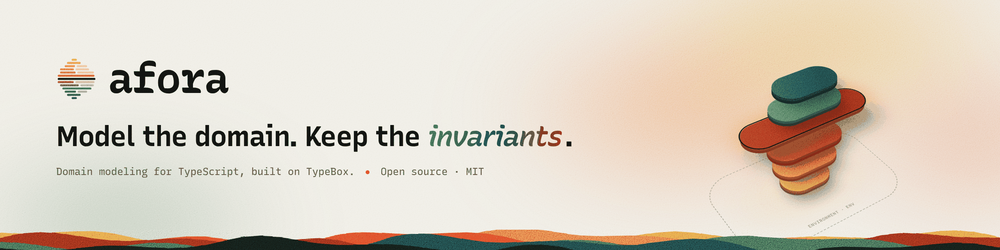
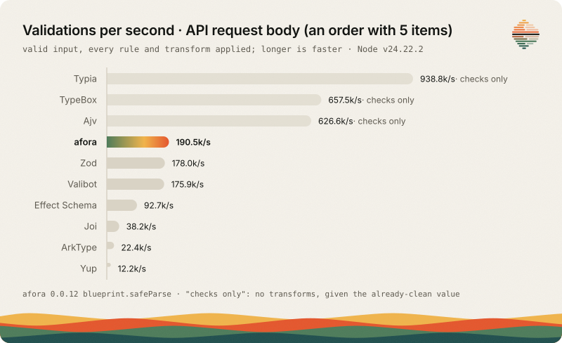

<p align="center">
  <picture>
    <source media="(prefers-color-scheme: dark)" srcset=".github/assets/afora-banner-dark.png">
    
  </picture>
</p>

<p align="center">
  <a href="https://www.npmjs.com/package/@afora/core"></a>
  <a href="https://github.com/afora-framework/core/actions/workflows/ci.yml"></a>
  <a href="https://www.npmjs.com/package/@afora/core"></a>
  <a href="https://standardschema.dev"></a>
  = 1.4.4 and Node >= 22" src="https://img.shields.io/badge/runtime-Bun%20%E2%89%A5%201.4.4%20%7C%20Node%20%E2%89%A5%2022-555">
  <a href="LICENSE"></a>
</p>

<p align="center">
  <a href="https://getafora.com">Website</a> ·
  <a href="docs/README.md">Docs</a> ·
  <a href="#quick-start">Quick start</a> ·
  <a href="docs/afora-json.md">afora.json</a> ·
  <a href="CHANGELOG.md">Changelog</a> ·
  <a href="https://github.com/afora-framework/core/discussions">Discussions</a>
</p>

**A backend an agent can write without breaking its guarantees.** With afora the whole application is data: an `afora.json` declares the entities, repositories, use cases, commands and HTTP API, [`@afora/codegen`](packages/codegen/README.md) turns it into TypeScript you review and commit, [`@afora/mcp`](packages/mcp/README.md) lets an agent write it, and `extractSpec(app)` gives the spec back from code written by hand. Whoever writes the spec or the code, the runtime keeps the invariants: sensitive fields are masked, undeclared keys are rejected, unique keys are enforced and business errors become problem+json with the right status.

### 30 seconds: from afora.json to a running API

```bash
bun add @afora/core @afora/hono hono typebox && bun add -d @afora/codegen
bunx afora-codegen generate afora.json --stages ./stages.ts   # writes src/domain/*.ts
bun src/server.ts
```

With the [quick start's `afora.json`](#the-same-app-as-an-aforajson) and three small files written by hand (the hashing function, the `hono` stage catalog and the server, shown there), that is the whole API: a `User` with a masked password and a unique email, a use case written as steps, problem+json errors and an OpenAPI document. The same app written by hand in TypeScript is the [quick start](#quick-start), and the [afora.json guide](docs/afora-json.md) covers the whole spec.

## Why afora

An HTTP backend written by an agent (or in a hurry) tends to break the same few guarantees. In afora each one is a mechanism of the runtime, not a convention the code has to remember:

| What usually breaks                            | What afora does                                                                                                                                                                                         |
| ---------------------------------------------- | ------------------------------------------------------------------------------------------------------------------------------------------------------------------------------------------------------- |
| A password hash or token ends up in a response | A property declared `sensitive` (`Password`) is masked by `toJSON()` at any depth, so no serializer can leak it ([records](docs/records.md)).                                                           |
| Extra fields in a request body are accepted    | Records reject undeclared keys at any depth (issue code `undeclared_key`), and the HTTP sink answers 400 ([Standard Schema](docs/standard-schema.md)).                                                  |
| A business error is returned as a 500          | Exceptions know their layer; an output maps them to problem+json with a status (404, 409, 401, 422 for the errors a use case declares) and hides the detail of a real 500 ([outputs](docs/outputs.md)). |
| A duplicate email is written twice             | `unique` keys are enforced by the repository and its provider, and a violation is a 409 ([repositories](docs/repositories.md)).                                                                         |

[`examples/agent-built`](examples/agent-built/README.md) checks these four invariants on the running API of a ticketing backend built only through the MCP server, and of a Hono + Zod baseline written from the same brief. In the committed run both hold all four, but the afora one wrote no code for any of them: the spec declares the fields and errors, and the runtime does the rest. Scripted runs that measure how often each approach holds them across independent agent runs are in the example, waiting to be run with an API key.

afora is not a general-purpose validator. It models a domain on [TypeBox](https://github.com/sinclairzx81/typebox), and every field plugs into the validators your framework already accepts through [Standard Schema](https://standardschema.dev).

## Features

- **Records with invariants.** Properties (`Email`, `Slug`, `Password`, your own) validate and normalize every value; blueprints compose them; a record (`class User extends recordOf(...)`) holds the handled value and rejects undeclared keys at any depth.
- **Sensitive data masking.** A property declared `sensitive` (`Password`) is masked by `toJSON()` at any depth, so `JSON.stringify(user)` cannot leak it.
- **Entities, repositories and use cases.** `entityOf` adds identity, timestamps and domain events; `repositoryOf` generates typed `findBy<Key>` methods for the keys in `options.unique` and enforces them; use cases inject repositories and environments and can override them per call.
- **Typed change namespace and side effects.** `change: ["password"]` generates `change.password(value)` (also destructurable, as `const { change } = user`), which re-validates the value and runs `onSetAll` and `onSet`.
- **Exceptions that know their layer.** Each error carries a layer (`Property`, `Record`, `UseCase`, `Output`...) and a `trace` that grows as it goes up.
- **Standard Schema V1 on every field.** Properties, blueprints, lists and record classes work as is in Hono, tRPC and TanStack Form, and `safeParse` never throws for an invalid value.
- **Commands and outputs.** `commandOf` groups use cases behind one execution boundary (context, transactions, event policies); `outputOf` turns commands into operations and pipes them to a sink: an HTTP API with `@afora/hono`, WebSocket messages with `@afora/ws`, an OpenAPI 3.1 document, or MCP tools, with problem+json errors and masked responses.
- **Standard use cases.** `commandOf({ useCases: (ctx) => ({ create: ctx.create(Posts), publish: ctx.publish(Posts) }) })` picks ready-made use cases that follow the repository and its entity: the actions it declares, its record plugins and the properties of its keys ([docs](docs/std-use-cases.md)).
- **The whole application in JSON.** An `afora.json` generates the code (`@afora/codegen`), use cases included, as data (steps), and `extractSpec(app)` gives back the `afora.json` of an application written by hand.
- **Repositories on any store.** A provider contract with typed queries, soft deletion and transactions, a runner-agnostic kit to test one (`@afora/core/testing`), in memory by default, on Drizzle ORM with `@afora/drizzle` and on DynamoDB with `@afora/dynamodb`.

## Install

```bash
bun add @afora/core typebox   # or: npm install @afora/core typebox
```

Requirements: [Bun](https://bun.sh) >= 1.4.4 or Node.js >= 22. TypeBox (`typebox`, version `^1`) is a required peer dependency, shared with your application and afora's companion packages. The package ships ESM with TypeScript declarations; TypeScript >= 5.5 is an optional peer dependency.

`Password` hashes with argon2id: with `Bun.password` on Bun, with native `node:crypto` argon2 on a Node that has it (24.7+), and otherwise it throws `PasswordHasherRequired` until you call `configure({ hasher })`. `Id.generate()` makes a portable, monotonic UUID v7 on any runtime. afora imports no `node:crypto` (or `Buffer`) at load, so it loads in browsers and Workers; the native hasher is looked up on first use through `process.getBuiltinModule` (Node 22.3+). The native hasher derives argon2 version 19 only; a hash of another version throws `UnsupportedPasswordHash` (verify it with `Bun.password`, or `configure({ hasher })`).

```ts
import { configure, type PasswordHasher } from "@afora/core";

const hasher: PasswordHasher = {
	hash: (plain) => myArgon2.hash(plain),
	verify: (plain, hash) => myArgon2.verify(plain, hash),
	verifySync: (plain, hash) => myArgon2.verifySync(plain, hash), // optional; `Password.verifySync` throws without it
};
configure({ hasher, idGenerator: () => myUuidV7() }); // both optional; `resetRuntime()` restores the defaults
```

## Quick start

A `User` entity with a sensitive key and a unique key, a repository, a use case written as steps, a command that wraps it in a transaction, and an output that serves the command as an HTTP API with an OpenAPI document. Install what it uses:

```bash
bun add @afora/core @afora/hono hono typebox
```

Save this as `quickstart.ts` and run `bun quickstart.ts`. It is the code of `examples/interop/quickstart.ts`, run by `bun run test:interop` (there the imports resolve to the local sources).

```ts
import {
	blueprintOf,
	commandOf,
	ExceptionLayers,
	entityOf,
	exceptionOf,
	outputOf,
	Password,
	repositoryOf,
	useCaseOf,
} from "@afora/core";
import { hono } from "@afora/hono";

// Entity: invariants, a sensitive key and a unique key
export class User extends entityOf(
	blueprintOf((ctx) => ({
		name: ctx.text,
		email: ctx.email, // trimmed and lowercased
		password: ctx.password, // only an argon2 hash is accepted; always masked
	})),
	{ unique: ["email"] },
) {}

// Repository: only the actions you choose; the provider is in memory by default
const Users = repositoryOf({
	entity: User,
	actions: ["findByEmail", "create"],
});

const UserAlreadyExists = exceptionOf({
	layer: ExceptionLayers.UseCase,
	name: "UserAlreadyExists",
	message: "A user with this email already exists.",
});

async function hashPassword(plain: string) {
	return (await Password.hash(plain)).value;
}

// Use case: the steps are data, so they can also live in an afora.json
class Register extends useCaseOf({
	name: "Register",
	blueprint: blueprintOf((ctx) => ({
		name: ctx.text,
		email: ctx.email,
		plainPassword: ctx.string,
	})),
	response: blueprintOf(() => ({ user: User })),
	dependencies: { users: Users },
	errors: [UserAlreadyExists],
	steps: [
		{ find: "users.findByEmail", args: ["$input.email"], as: "existing" },
		{ ensure: "absent", value: "$existing", error: UserAlreadyExists },
		{
			run: "hashPassword",
			fn: hashPassword,
			args: ["$input.plainPassword"],
			as: "hash",
		},
		{
			build: User,
			values: { name: "$input.name", email: "$input.email", password: "$hash" },
			as: "user",
		},
		{ create: "users", value: "$user", as: "saved" },
		{ return: { user: "$saved" } },
	],
}) {}

// Command: the execution boundary (here, one transaction per call)
const Accounts = commandOf({
	name: "Accounts",
	useCases: { register: Register },
	transaction: true,
});

// Output: the commands as an HTTP API with an OpenAPI document
const Api = outputOf({
	name: "Api",
	commands: [Accounts],
	statuses: { UserAlreadyExists: 409 },
	pipe: [
		hono({
			basePath: "/api",
			docs: {
				path: "/openapi.json",
				info: { title: "Accounts", version: "1.0.0" },
			},
		}),
	],
});

export const api = Api.build();

if (import.meta.main) Bun.serve({ fetch: api.fetch });
```

What it does:

```
POST /api/accounts/register  { "name": "Ana", "email": "  Ana@Example.COM ", "plainPassword": "Str0ng!Pass" }
-> 200 { "user": { "id": "...", "name": "Ana", "email": "ana@example.com", "password": "********", ... } }

the same email again
-> 409 application/problem+json  { "title": "UserAlreadyExists", "layer": "use-case", ... }

{ "name": "Ana", "email": "nope" }
-> 400 application/problem+json  { ..., "issues": [{ "path": ["email"], ... }, { "path": ["plainPassword"], ... }] }

GET /openapi.json -> the OpenAPI 3.1 document of the route
```

### The same app as an afora.json

Everything above, except the hashing function, is data, so it can be written as an `afora.json` and generated. `@afora/codegen` writes the TypeScript you would have written by hand (the classes above, plus an `applicationOf`), committed and reviewable. This is `examples/interop/quickstart.afora.json`, which the same test validates and generates.

```json
{
	"version": 1,
	"name": "accounts",
	"output": { "dir": "src/domain" },
	"provider": "inMemory",
	"entities": {
		"User": {
			"fields": { "name": "text", "email": "email", "password": "password" },
			"unique": ["email"]
		}
	},
	"repositories": {
		"Users": { "entity": "User", "actions": ["findByEmail", "create"] }
	},
	"exceptions": {
		"UserAlreadyExists": {
			"layer": "use-case",
			"message": "A user with this email already exists."
		}
	},
	"useCases": {
		"Register": {
			"input": {
				"fields": {
					"name": "text",
					"email": "email",
					"plainPassword": "string"
				}
			},
			"response": { "fields": { "user": "User" } },
			"dependencies": { "users": "Users" },
			"errors": ["UserAlreadyExists"],
			"implementation": {
				"steps": [
					{
						"find": "users.findByEmail",
						"args": ["$input.email"],
						"as": "existing"
					},
					{
						"ensure": "absent",
						"value": "$existing",
						"error": "UserAlreadyExists"
					},
					{
						"run": "hashPassword",
						"fn": { "import": "../hash-password.ts#hashPassword" },
						"args": ["$input.plainPassword"],
						"as": "hash"
					},
					{
						"build": "User",
						"values": {
							"name": "$input.name",
							"email": "$input.email",
							"password": "$hash"
						},
						"as": "user"
					},
					{ "create": "users", "value": "$user", "as": "saved" },
					{ "return": { "user": "$saved" } }
				]
			}
		}
	},
	"commands": {
		"Accounts": { "useCases": { "register": "Register" }, "transaction": true }
	},
	"outputs": {
		"Api": {
			"commands": ["Accounts"],
			"statuses": { "UserAlreadyExists": 409 },
			"pipe": [
				{
					"sink": "hono",
					"options": {
						"basePath": "/api",
						"docs": {
							"path": "/openapi.json",
							"info": { "title": "Accounts", "version": "1.0.0" }
						}
					}
				}
			]
		}
	}
}
```

The `run` step names a function written by hand, imported relative to the output directory. Put it in `src/hash-password.ts`:

```ts
import { Password } from "@afora/core";

export async function hashPassword(plain: string) {
	return (await Password.hash(plain)).value;
}
```

Then generate, telling codegen where the `hono` stage comes from in `stages.ts`:

```ts
export { stages } from "@afora/hono";
```

```bash
bun add -d @afora/codegen
bunx afora-codegen generate afora.json --stages ./stages.ts   # writes src/domain/*.ts
```

and serve the application from `src/server.ts` (`bun src/server.ts`):

```ts
import { App } from "./domain/index.ts";

await App.start();
export const api = App.outputs.Api.build();

if (import.meta.main) Bun.serve({ fetch: api.fetch });
```

These three files are `examples/interop/from-json`, which `bun run test:interop` generates and serves.

`generate` writes one file per kind (`entities.ts`, `repositories.ts`, `use-cases.ts`, `commands.ts`, `outputs.ts`...), an `application.ts` and an `index.ts`, each starting with a banner saying not to edit it. `afora-codegen extract` goes the other way and gives the `afora.json` of an `Application`. The guide is in [docs/afora-json.md](docs/afora-json.md).

## What you get

Each concept has a page in [docs/](docs/README.md), in the order they build on one another:

- [Properties](docs/properties.md): one validated and normalized value, with flags for `sensitive` and `unique`.
- [Blueprints](docs/blueprints.md): an object shape built from properties, lists, optionals and nested blueprints.
- [Records](docs/records.md): a class that holds the handled value, masks sensitive keys and generates `change.<key>`; plugins; experimental slicing.
- [Entities](docs/entities.md): a record with identity, timestamps, `destroy()` and domain events.
- [Repositories](docs/repositories.md): typed async methods for an entity, queries, soft deletion, providers, transactions and relations.
- [Schema evolution](docs/schema-evolution.md): `fill`, `renamedFrom`, `schemaVersion` with `upgrade` steps and `previousNames`, so old rows are still read; `app.migrate` to rewrite them, and a schema lock checked in CI and on `start`.
- [Use cases](docs/use-cases.md): the Command pattern with method injection, written as code or as steps.
- [Commands](docs/commands.md): use cases under operation names, with a context, a transaction and an event policy.
- [Outputs](docs/outputs.md): commands through stages into a sink, such as an HTTP API or an OpenAPI document.
- [Applications](docs/applications.md): a named, checked manifest of every declaration, and `describe()`.
- [Exceptions](docs/exceptions.md): errors that know their layer and keep a trace.
- [Environments](docs/environments.md): validated environment variables.
- [Standard Schema](docs/standard-schema.md), [OpenAPI](docs/openapi.md) and the [afora.json guide](docs/afora-json.md).

## Standard Schema

Every field (a property, blueprint, list or record class) implements Standard Schema V1 (`vendor: "afora"`), so Hono, tRPC, TanStack Form and any other library that takes one takes it as is. `validate` is synchronous, never throws for an invalid value and reports every issue with its `path`. Without a framework, `safeParse` returns `{ value }` or `{ issues }`. See [docs/standard-schema.md](docs/standard-schema.md); the real-library tests are in `examples/interop`.

## Packages

| Package                                                    | What it does                                                                                                                                                  |
| ---------------------------------------------------------- | ------------------------------------------------------------------------------------------------------------------------------------------------------------- |
| [`@afora/core`](https://www.npmjs.com/package/@afora/core) | Properties, blueprints, records, entities, repositories, use cases, commands and outputs (this repository's root).                                            |
| [`@afora/codegen`](packages/codegen/README.md)             | Generates afora code from an `afora.json`, and extracts the `afora.json` of an `Application` back.                                                            |
| [`@afora/mcp`](packages/mcp/README.md)                     | An MCP server that lets an agent build a domain with `@afora/codegen`.                                                                                        |
| [`@afora/hono`](packages/hono/README.md)                   | A `hono` sink for outputs: serves the operations as a Hono app, with problem+json errors, masked responses, signed webhooks and an optional OpenAPI document. |
| [`@afora/ws`](packages/ws/README.md)                       | A `websocket` sink: operations over JSON messages on any runtime, with topic subscriptions that `publishEvents` feeds with domain events.                     |
| [`@afora/drizzle`](packages/drizzle/README.md)             | A repository provider on Drizzle ORM (SQLite and Postgres) that passes the provider contract kit.                                                             |
| [`@afora/dynamodb`](packages/dynamodb/README.md)           | A repository provider on one DynamoDB table (single-table layout, unique keys as marker items) that passes the provider contract kit on DynamoDB Local.       |

## Example

`examples/blog` is a blog (users with the `authenticatable` plugin, posts with soft deletion, every use case a [standard one](docs/std-use-cases.md), a Hono API on Drizzle and SQLite) whose whole `src/domain` is generated from one `afora.json` by `@afora/codegen`. Only the database, the schema, the provider (made from a `Database` environment with `providerFrom` when the server calls `App.start()`, and named `database` in the `providers` of the spec) and the server are hand-written. Its tests check that the committed code is what the spec generates, drive the API end to end and extract the spec back from the application: `bun run test:blog`.

`examples/agent-built` is an event ticketing API (organizers, events with a capacity, tickets) built only through the `@afora/mcp` tools from a written brief, with the tool calls committed and replayed byte for byte, and an evaluation of four invariants on its running API and on a Hono + Zod baseline: `bun run test:agent-built`. See [its write-up](examples/agent-built/README.md).

## Performance

`bun run bench` times afora next to TypeBox (compiled), Ajv, Typia, Zod 4, Valibot, ArkType, Effect Schema, Yup and Joi on seven scenarios (a flat object, a nested one, the body of an API request, a list of 1,000 items, a union, six levels of nesting, and a flat object with nothing to transform), with valid and invalid input, on Bun and on Node. Every library declares the same rules, rejects undeclared keys and collects every error, and is checked before it is timed; each row is timed by a process of its own, after a warm-up, in three rounds. The tables are in [`bench/RESULTS.md`](bench/RESULTS.md) and the method in [`bench/README.md`](bench/README.md). Absolute numbers depend on the machine, so read the ratios.

<!-- bench:start -->



Time of each library as a multiple of afora `blueprint.safeParse` on the same case: above 1.00x it is slower than afora, below it is faster. TypeBox, Ajv and Typia only check, they do not transform. afora 0.0.8, Bun 1.4.4 and Node v24.22.2, AMD EPYC 9V45 96-Core Processor; generated from `bench/results/latest.json`.

| Node                                                     |    afora | TypeBox |   Ajv | Typia |   Zod | Valibot | ArkType | Effect Schema |    Yup |    Joi |
| -------------------------------------------------------- | -------: | ------: | ----: | ----: | ----: | ------: | ------: | ------------: | -----: | -----: |
| Small flat object, valid                                 | 299.5 ns |   0.13x | 0.14x | 0.15x | 1.23x |   1.97x |  10.30x |         2.74x | 12.44x |  8.25x |
| Small flat object, invalid                               | 474.6 ns |   9.50x | 0.13x | 0.58x | 3.22x |   2.71x |  27.57x |         4.04x | 68.43x |  7.66x |
| Nested user (address, 5 tags max, 10 addresses), valid   |  2036 ns |   0.12x | 0.17x | 0.13x | 1.27x |   1.02x |  14.85x |         3.24x | 22.52x |  6.67x |
| Nested user (address, 5 tags max, 10 addresses), invalid |  2688 ns |   9.83x | 0.15x | 0.83x | 1.84x |   1.21x |  21.43x |         3.46x | 38.49x |  6.84x |
| API request body (an order with 5 items), valid          |  2518 ns |   0.35x | 0.35x | 0.24x | 1.21x |   1.16x |   9.55x |         2.46x | 17.06x |  5.63x |
| API request body (an order with 5 items), invalid        |  3540 ns |   5.17x | 0.12x | 0.86x | 1.90x |   1.10x |  14.67x |         2.50x | 30.63x |  5.11x |
| List of 1,000 items, valid                               | 152.4 µs |   0.06x | 0.10x | 0.06x | 0.67x |   2.34x |  20.61x |         3.96x | 27.77x |  7.40x |
| List of 1,000 items, invalid                             | 155.5 µs |  20.58x | 0.10x | 0.18x | 0.72x |   2.35x |  26.62x |         3.70x | 28.82x |  7.43x |
| Union of 4 variants (12 events), valid                   | 579.7 ns |   0.47x | 0.59x | 0.51x | 3.90x |  14.54x |   1.54x |        13.42x | 91.04x | 94.11x |
| Union of 4 variants (12 events), invalid                 |  55.0 µs |   0.64x | 0.01x | 0.03x | 0.09x |   0.19x |   0.34x |         0.17x |  1.44x |  1.69x |
| 6 levels of nesting, valid                               | 829.3 ns |   0.06x | 0.09x | 0.06x | 0.78x |   1.13x |  14.16x |         4.12x | 19.31x |  5.65x |
| 6 levels of nesting, invalid                             | 971.4 ns |  21.55x | 0.10x | 1.69x | 1.99x |   1.72x |  27.50x |         5.35x | 52.46x |  7.37x |
| Small flat object, checks only, valid                    | 177.6 ns |   0.23x | 0.24x | 0.25x | 0.82x |   2.68x |   0.44x |         2.34x | 18.10x | 12.73x |
| Small flat object, checks only, invalid                  | 424.3 ns |  10.48x | 0.15x | 0.68x | 2.94x |   2.85x |  22.80x |         3.92x | 74.92x |  8.39x |

| Bun                                                      |    afora | TypeBox |   Ajv | Typia |   Zod | Valibot | ArkType | Effect Schema |    Yup |    Joi |
| -------------------------------------------------------- | -------: | ------: | ----: | ----: | ----: | ------: | ------: | ------------: | -----: | -----: |
| Small flat object, valid                                 | 195.7 ns |   0.15x | 0.18x | 0.17x | 1.63x |   0.95x |  10.95x |         2.58x | 22.27x | 10.44x |
| Small flat object, invalid                               | 426.1 ns |   7.87x | 0.21x | 1.26x | 1.62x |   0.97x |  16.14x |         2.50x | 39.07x |  8.12x |
| Nested user (address, 5 tags max, 10 addresses), valid   |  3154 ns |   0.05x | 0.08x | 0.03x | 0.93x |   0.41x |   4.73x |         1.35x | 16.66x |  3.81x |
| Nested user (address, 5 tags max, 10 addresses), invalid |  2260 ns |   8.15x | 0.16x | 0.99x | 1.64x |   0.91x |  13.57x |         2.40x | 39.16x |  6.88x |
| API request body (an order with 5 items), valid          |  2355 ns |   0.19x | 0.21x | 0.32x | 1.34x |   0.68x |   5.08x |         1.83x | 21.04x |  4.97x |
| API request body (an order with 5 items), invalid        |  2456 ns |   5.33x | 0.13x | 1.13x | 2.06x |   0.97x |  11.38x |         2.24x | 38.34x |  7.81x |
| List of 1,000 items, valid                               | 185.7 µs |   0.02x | 0.05x | 0.01x | 1.05x |   0.45x |   7.61x |         1.53x | 29.36x |  5.07x |
| List of 1,000 items, invalid                             |  92.7 µs |  23.63x | 0.12x | 0.45x | 2.25x |   0.96x |  23.45x |         3.00x | 65.59x | 11.20x |
| Union of 4 variants (12 events), valid                   |  1627 ns |   0.11x | 0.14x | 0.20x | 1.83x |   1.97x |   0.26x |         2.06x | 39.17x | 27.28x |
| Union of 4 variants (12 events), invalid                 |  41.8 µs |   0.64x | 0.01x | 0.04x | 0.10x |   0.11x |   0.21x |         0.11x |  1.81x |  2.01x |
| 6 levels of nesting, valid                               | 528.2 ns |   0.02x | 0.10x | 0.06x | 1.98x |   1.54x |  11.94x |         2.87x | 39.56x |  7.63x |
| 6 levels of nesting, invalid                             | 838.9 ns |  17.86x | 0.09x | 1.60x | 1.74x |   1.59x |  18.13x |         3.09x | 53.04x |  7.92x |
| Small flat object, checks only, valid                    | 110.1 ns |   0.28x | 0.35x | 0.29x | 1.83x |   0.92x |   0.34x |         1.91x | 33.82x | 15.15x |
| Small flat object, checks only, invalid                  | 414.7 ns |   7.74x | 0.21x | 1.25x | 1.52x |   0.86x |  11.63x |         2.06x | 39.99x |  7.60x |

<!-- bench:end -->

What the table says, for `blueprint.safeParse`, on a GitHub runner (AMD EPYC, Linux, Bun 1.4.4 and Node 24). The table is of afora at commit `8c4395e`; what changed after it is said where it applies.

- **Against Zod 4.** On Bun, faster in 12 of the 14 cases, by 1.05x to 2.25x; Zod 4 is ahead on the valid nested object (7%). On Node, faster in 9 of the 14, by 1.2x to 3.9x; Zod 4 is ahead on the list of 1,000 items (1.4x to 1.5x), on the valid deep object (1.3x) and on the valid flat object with nothing to transform (1.2x). The invalid union is told apart below.
- **Against Valibot.** On Node afora is faster in 13 of the 14 cases, by 1.02x to 2.9x outside the valid union (14.5x). On Bun it is the other way: Valibot is ahead in 10 of them, within 10% on small objects and by 1.5x to 2.4x on the valid nested object, the valid API body and the valid list, and afora is ahead on the valid union (2x) and the deep object (1.5x to 1.6x).
- **Against Effect Schema, Joi and Yup.** Faster in every case but the invalid union: 1.35x to 5.4x Effect Schema (13x on the valid union on Node), 3.8x to 15x Joi, 12x to 75x Yup.
- **Against ArkType.** Faster wherever a value is transformed or rejected, by 4.7x to 28x, because its morphs and its errors take a slower path. With nothing to transform and a valid value, ArkType is 2.3x to 3x faster than afora, and 3.8x on the valid union on Bun.
- **An invalid union.** In the table it takes about 10x the time of Zod 4: TypeBox `Errors` reported every variant of the union for each rejected value. Since then a property whose schema is a discriminated union tells a rejected value by the variant it names, without `Errors`, and takes about 0.5x the time of Zod 4 on Bun (measured on an Apple M2; the table follows at the next measurement). Valid values of the same union are 1.8x to 3.9x faster than Zod 4.
- **Floor.** The checkers that compile and do not transform (TypeBox, Ajv, Typia) are 3x to 9x faster than afora on a valid small object, and 10x to 70x on the larger ones. afora builds on TypeBox. On invalid input afora is 5x to 24x faster than TypeBox `Errors` (outside the union), and Ajv stays 5x to 11x ahead.
- **Records and entities.** `Record.safeParse`, which also creates the instance, takes 1.0x to 2.1x the time of `blueprint.safeParse` on Bun and up to 4x on Node. `Entity.safeParse` also makes an id and the time stamps, which on a small object is most of its time: 5x to 13x `blueprint.safeParse` on the flat object in the table, 1.0x to 4.7x on the larger ones; since then it takes about three quarters of that on a small object, for not checking again the id and the date it has just made. `new Record(value)` throws on invalid input, which costs an exception with its trace (2x to 6x `blueprint.safeParse` on Bun, 2.5x to 13x on Node); use `safeParse` where invalid input is expected.
- **Bundle and cold start.** afora is a framework with one entry point: validating one object bundles to 100 kB gzipped (Zod 4: 24 kB, Valibot: 1.7 kB) and takes 40 ms to load, build and run once in a new Node process (85 ms on Bun; Zod 4: 7 to 8 ms).

What afora does that the fast rows do not all do: a pipeline per property (`preHandle`, schema check, `afterHandle`), where a property with a handler has the shape of the value checked first, so handlers only see the right types; objects walked key by key instead of one compiled function; frozen results; every issue with `code`, `path` and `source`; and, for `Record.safeParse` and `new Record`, creating the instance. If you validate bulk data in a hot path and need none of that, a compiled checker alone is an order of magnitude faster.

CI keeps it there: `bun run bench:guard` times `blueprint.safeParse` and Zod 4 `safeParse` on the fourteen cases and fails when afora is over the limit of a case as a multiple of Zod 4 (1.15x unless `bench/guard.limits.ts` states another, with the reason).

## Comparison

A rough guide, not a verdict. "Partial" means it is possible but not what the library is for.

|                             | afora                                          | Zod 4               | Valibot        | Effect Schema                      |
| --------------------------- | ---------------------------------------------- | ------------------- | -------------- | ---------------------------------- |
| Standard Schema V1          | yes, on every field                            | yes                 | yes            | yes                                |
| Transforms                  | yes (`preHandle`, `afterHandle`)               | yes                 | yes            | yes                                |
| Domain entities / classes   | yes (records with change methods and effects)  | no                  | no             | partial (`Schema.Class`)           |
| Sensitive masking           | yes (`sensitive`, in `toJSON`)                 | no                  | no             | partial (`Redacted`)               |
| Layered errors with a trace | yes (`ExceptionLayers`, `trace`)               | no                  | no             | partial (tagged errors, no layers) |
| Runtime speed               | slower; see Performance                        | faster              | faster         | not measured here                  |
| Bundle size                 | not measured; depends on TypeBox and `slugify` | larger than Valibot | small, modular | larger                             |
| Ecosystem and maturity      | new, small                                     | very large          | large          | large, in the Effect ecosystem     |

Where the others win: Zod and Valibot are faster, have far larger ecosystems and documentation, and have integrations and code generators for most tools; Valibot is modular and small; Effect Schema fits a codebase already built on Effect. afora gives up those to model entities, masking and layers in the type you already validate with.

## Contributing

Read [CONTRIBUTING.md](CONTRIBUTING.md) for the setup, the checks and how releases work. Issues open from a template: bug report, feature request, or feedback from building on afora. Questions go to [Discussions](https://github.com/afora-framework/core/discussions); security issues go through [SECURITY.md](SECURITY.md), never a public issue.

Commits follow [Conventional Commits](https://www.conventionalcommits.org) (`feat(repository): …`, `fix: …`), checked by commitlint in a Husky `commit-msg` hook; the `pre-commit` hook runs Biome and Knip. CI runs lint, Knip, type checks, unit and interop tests, the build and the Node smoke test on every push and pull request. A pull request that bumps the version in `package.json`, once merged to `main`, publishes to npm with provenance and creates the tag and the GitHub release.

Scripts:

```bash
bun install
bun test              # unit tests
bun check             # type check
bun run test:types    # build, then type-check the packed package on TypeScript, bundler and nodenext resolution
bun run test:type-perf # build, then budget the editor cost per edit and snapshot hovers, completions and errors
bun run test:api      # build, then snapshot the public surface (exports and declarations) and the afora.json schema
bun run test:interop  # Hono, tRPC and TanStack Form tests (examples/interop), including the quick start
bun run test:blog     # the generated blog (examples/blog): drift, API and extraction
bun run test:agent-built # the agent-built example (examples/agent-built): drift, replay, API and the invariant evaluation
bun run smoke         # build, then run the package on plain Node
bun run bench         # benchmark against TypeBox, Ajv, Typia, Zod, Valibot, ArkType, Effect Schema, Yup and Joi
bun run lint          # biome lint
bun run knip          # unused files, exports and dependencies
bun run fmt           # biome format + fix
bun run build         # build dist/ (ESM + .d.ts)
bun run test:codegen  # tests of packages/codegen
bun run test:mcp      # tests of packages/mcp
bun run test:hono     # tests of packages/hono
bun run test:ws       # tests of packages/ws
bun run test:drizzle  # tests of packages/drizzle (SQLite and PGlite)
bun run test:dynamodb # tests of packages/dynamodb (DynamoDB Local, with DYNAMODB_ENDPOINT)
bun run build:packages # build the core, then packages/codegen, packages/mcp, packages/hono, packages/ws, packages/drizzle and packages/dynamodb
```

## Versioning

What is stable, what may break and how deprecations work is in [VERSIONING.md](VERSIONING.md).

## License

MIT
