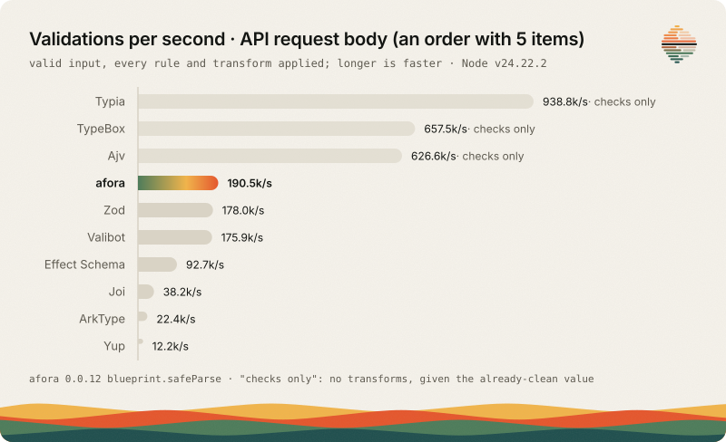

# Performance

How fast afora validates, how that is measured, and what CI does to keep it from getting slower. The numbers below are generated from the committed run (`bench/results/latest.json`). They change with the machine, so read the ratios, and read [bench/RESULTS.md](../bench/RESULTS.md) for the full tables. Performance numbers are not part of the [contract](../VERSIONING.md).

## What is measured

`bun run bench` times afora next to TypeBox (compiled), Ajv, Typia, Zod 4, Valibot, ArkType, Effect Schema, Yup and Joi, on seven scenarios, each with a valid and an invalid input (fourteen cases):

| Scenario       | Shape                                                             |
| -------------- | ----------------------------------------------------------------- |
| `flat`         | A small object with three fields, trimmed and lowercased.         |
| `nested`       | The flat user plus an address, a list of tags and ten addresses.  |
| `api-payload`  | The body of a request: an order with five items, an enum, a uuid. |
| `large-list`   | One object that holds 1,000 small items.                          |
| `union`        | Twelve events, each one of four variants told apart by `type`.    |
| `deep`         | Six objects, one inside the other.                                |
| `no-transform` | The flat object with nothing to transform.                        |

Every library declares the same rules, rejects undeclared keys and collects every error instead of stopping at the first, which is what afora always does. A contender that accepts the invalid input, rejects the valid one or lets an undeclared key through stops the run, so no row is fast for skipping a rule. Each row is timed in a process of its own, after a warm-up, in three rounds, and the best round counts. The method, the fairness rules and how to contest a row are in [bench/README.md](../bench/README.md).

It also measures bundle size (minified and gzipped, each library validating the flat object) and cold start (the time a new process takes to import that bundle, median of 15 processes).

## What the numbers say

afora does more per value than a checker: it normalizes, collects every issue, and returns frozen values. TypeBox, Ajv and Typia only check, so they are faster on valid input and are marked "no transforms" in the tables.

<!-- bench:start -->



Time of each library as a multiple of afora `blueprint.safeParse` on the same case: above 1.00x it is slower than afora, below it is faster. TypeBox, Ajv and Typia only check, they do not transform. afora 0.0.11, Bun 1.4.4, Node v22.23.4 and Node v24.22.2, AMD EPYC 9V74 80-Core Processor; generated from `bench/results/latest.json`.

| Node 24                                                  |    afora | TypeBox |   Ajv | Typia |   Zod | Valibot | ArkType | Effect Schema |     Yup |     Joi |
| -------------------------------------------------------- | -------: | ------: | ----: | ----: | ----: | ------: | ------: | ------------: | ------: | ------: |
| Small flat object, valid                                 | 426.4 ns |   0.16x | 0.16x | 0.17x | 1.36x |   1.95x |  10.12x |         2.70x |  11.51x |   7.91x |
| Small flat object, invalid                               | 711.5 ns |   8.29x | 0.13x | 0.58x | 2.99x |   2.32x |  25.36x |         3.90x |  61.50x |   6.95x |
| Nested user (address, 5 tags max, 10 addresses), valid   |  3210 ns |   0.11x | 0.16x | 0.11x | 1.22x |   1.08x |  12.43x |         2.87x |  20.26x |   5.75x |
| Nested user (address, 5 tags max, 10 addresses), invalid |  4166 ns |   8.22x | 0.14x | 0.75x | 1.63x |   1.18x |  19.51x |         3.31x |  35.38x |   5.78x |
| API request body (an order with 5 items), valid          |  3977 ns |   0.29x | 0.29x | 0.20x | 1.16x |   1.09x |   8.13x |         2.11x |  15.07x |   4.86x |
| API request body (an order with 5 items), invalid        |  5162 ns |   4.34x | 0.13x | 0.81x | 1.75x |   1.08x |  13.59x |         2.26x |  28.57x |   4.72x |
| List of 1,000 items, valid                               | 244.7 µs |   0.06x | 0.09x | 0.06x | 0.65x |   2.22x |  17.93x |         3.16x |  24.94x |   7.13x |
| List of 1,000 items, invalid                             | 252.7 µs |  16.13x | 0.09x | 0.16x | 0.66x |   2.40x |  22.24x |         3.16x |  25.90x |   6.96x |
| Union of 4 variants (12 events), valid                   | 752.5 ns |   0.55x | 0.67x | 0.53x | 4.81x |  15.28x |   1.77x |        13.28x | 105.38x | 102.43x |
| Union of 4 variants (12 events), invalid                 |  4147 ns |  10.88x | 0.13x | 0.58x | 1.54x |   3.67x |   6.06x |         3.18x |  27.58x |  30.63x |
| 6 levels of nesting, valid                               |  1167 ns |   0.06x | 0.09x | 0.07x | 0.86x |   1.23x |  14.12x |         3.92x |  19.77x |   5.64x |
| 6 levels of nesting, invalid                             |  1490 ns |  18.43x | 0.09x | 1.50x | 2.03x |   1.65x |  23.77x |         4.80x |  48.76x |   6.53x |
| Small flat object, checks only, valid                    | 298.2 ns |   0.22x | 0.23x | 0.24x | 0.76x |   2.32x |   0.39x |         2.15x |  15.05x |  10.29x |
| Small flat object, checks only, invalid                  | 637.2 ns |   9.07x | 0.14x | 0.64x | 2.91x |   2.53x |  22.16x |         3.67x |  67.45x |   7.40x |

| Bun                                                      |    afora | TypeBox |   Ajv | Typia |   Zod | Valibot | ArkType | Effect Schema |    Yup |    Joi |
| -------------------------------------------------------- | -------: | ------: | ----: | ----: | ----: | ------: | ------: | ------------: | -----: | -----: |
| Small flat object, valid                                 | 275.4 ns |   0.16x | 0.19x | 0.18x | 1.72x |   0.94x |  10.40x |         2.68x | 22.28x | 11.56x |
| Small flat object, invalid                               | 654.8 ns |   5.84x | 0.20x | 1.04x | 1.41x |   0.85x |  14.27x |         2.42x | 37.07x |  8.01x |
| Nested user (address, 5 tags max, 10 addresses), valid   |  3905 ns |   0.06x | 0.10x | 0.04x | 1.04x |   0.48x |   5.23x |         1.66x | 18.99x |  4.18x |
| Nested user (address, 5 tags max, 10 addresses), invalid |  3089 ns |   7.70x | 0.17x | 1.01x | 1.68x |   0.95x |  13.39x |         2.71x | 41.23x |  7.50x |
| API request body (an order with 5 items), valid          |  3216 ns |   0.21x | 0.21x | 0.28x | 1.35x |   0.72x |   5.08x |         1.89x | 22.71x |  5.43x |
| API request body (an order with 5 items), invalid        |  3438 ns |   4.48x | 0.14x | 1.02x | 1.99x |   0.94x |  11.03x |         2.28x | 36.48x |  7.24x |
| List of 1,000 items, valid                               | 240.4 µs |   0.02x | 0.06x | 0.02x | 1.12x |   0.50x |   7.75x |         1.76x | 31.71x |  5.33x |
| List of 1,000 items, invalid                             | 138.0 µs |  19.36x | 0.12x | 0.42x | 2.05x |   0.93x |  22.69x |         3.04x | 62.42x |  9.97x |
| Union of 4 variants (12 events), valid                   |  1715 ns |   0.15x | 0.21x | 0.22x | 2.55x |   3.06x |   0.36x |         3.41x | 52.38x | 38.78x |
| Union of 4 variants (12 events), invalid                 |  2931 ns |  11.73x | 0.14x | 0.82x | 2.00x |   2.18x |   4.17x |         2.51x | 36.72x | 41.36x |
| 6 levels of nesting, valid                               | 721.9 ns |   0.03x | 0.11x | 0.06x | 2.10x |   1.41x |  11.58x |         3.34x | 40.39x |  8.63x |
| 6 levels of nesting, invalid                             |  1125 ns |  16.44x | 0.10x | 1.49x | 1.99x |   1.54x |  18.04x |         3.46x | 52.36x |  8.88x |
| Small flat object, checks only, valid                    | 160.6 ns |   0.28x | 0.32x | 0.31x | 1.85x |   0.97x |   0.36x |         2.14x | 34.51x | 15.23x |
| Small flat object, checks only, invalid                  | 635.6 ns |   6.15x | 0.21x | 1.08x | 1.30x |   0.79x |  10.50x |         1.89x | 36.83x |  7.67x |

| Node 22                                                  |    afora | TypeBox |   Ajv | Typia |   Zod | Valibot | ArkType | Effect Schema |     Yup |     Joi |
| -------------------------------------------------------- | -------: | ------: | ----: | ----: | ----: | ------: | ------: | ------------: | ------: | ------: |
| Small flat object, valid                                 | 385.1 ns |   0.17x | 0.17x | 0.17x | 1.43x |   1.11x |  11.10x |         2.86x |  14.03x |   8.77x |
| Small flat object, invalid                               | 709.3 ns |   8.23x | 0.14x | 0.59x | 2.95x |   0.96x |  25.88x |         3.97x | 110.94x |   6.91x |
| Nested user (address, 5 tags max, 10 addresses), valid   |  3288 ns |   0.11x | 0.19x | 0.11x | 1.17x |   1.03x |  12.32x |         2.74x |  23.78x |   5.50x |
| Nested user (address, 5 tags max, 10 addresses), invalid |  4184 ns |   8.24x | 0.17x | 0.73x | 1.66x |   1.17x |  19.48x |         3.13x |  52.90x |   5.77x |
| API request body (an order with 5 items), valid          |  3801 ns |   0.27x | 0.33x | 0.18x | 1.20x |   1.13x |   8.76x |         2.20x |  19.27x |   5.10x |
| API request body (an order with 5 items), invalid        |  4985 ns |   4.43x | 0.15x | 0.79x | 1.85x |   1.13x |  13.88x |         2.37x |  45.48x |   4.92x |
| List of 1,000 items, valid                               | 238.8 µs |   0.05x | 0.10x | 0.06x | 0.69x |   1.08x |  19.15x |         3.13x |  32.44x |   7.05x |
| List of 1,000 items, invalid                             | 246.4 µs |  16.31x | 0.12x | 0.16x | 0.70x |   1.06x |  24.95x |         2.97x |  34.54x |   7.05x |
| Union of 4 variants (12 events), valid                   | 702.6 ns |   0.57x | 0.78x | 0.57x | 5.35x |  10.30x |   2.40x |        13.86x | 136.79x | 108.60x |
| Union of 4 variants (12 events), invalid                 |  3849 ns |  11.77x | 0.15x | 0.63x | 1.74x |   2.24x |   6.66x |         3.15x |  40.08x |  33.39x |
| 6 levels of nesting, valid                               |  1139 ns |   0.06x | 0.10x | 0.07x | 0.85x |   1.28x |  14.51x |         3.92x |  23.69x |   5.97x |
| 6 levels of nesting, invalid                             |  1394 ns |  19.27x | 0.11x | 1.70x | 2.11x |   1.80x |  26.19x |         5.06x |  83.31x |   7.16x |
| Small flat object, checks only, valid                    | 269.8 ns |   0.25x | 0.24x | 0.24x | 0.85x |   1.05x |   0.53x |         2.25x |  18.19x |  11.42x |
| Small flat object, checks only, invalid                  | 641.7 ns |   9.07x | 0.15x | 0.66x | 2.71x |   0.92x |  22.17x |         3.67x | 121.83x |   7.39x |

<!-- bench:end -->

What the tables say, for `blueprint.safeParse` of afora 0.0.11, on a GitHub runner (AMD EPYC, Linux, Bun 1.4.4, Node 22 and Node 24).

- **Against Zod 4.** On Bun, faster in all 14 cases, by 1.04x (the valid nested object) to 2.55x. On Node, faster in 10 of the 14, by 1.15x to 5.35x; Zod 4 is ahead on the list of 1,000 items (1.4x to 1.5x), on the valid flat object with nothing to transform (1.2x to 1.3x) and on the valid deep object (1.15x to 1.2x). A rejected value of a discriminated union is told by the variant it names, without TypeBox `Errors`: 1.5x to 2x faster than Zod 4.
- **Against Valibot.** On Node 24 afora is faster in all 14 cases, by 1.08x to 3.7x outside the valid union (15x); on Node 22 in 12 of them, Valibot being ahead by 4% to 9% on the invalid flat objects. On Bun it is the other way: Valibot is ahead in 10 of them, by 3% to 27% on the small objects and the invalid inputs, by 1.4x on the valid API body and by 2x on the valid nested object and the valid list; afora is ahead on the deep object (1.4x to 1.5x) and the union (2.2x to 3x).
- **Against Effect Schema, Joi and Yup.** Faster in every case: 1.7x to 5.1x Effect Schema, 4.2x to 15x Joi and 11x to 122x Yup outside the union, and up to 14x, 109x and 137x on the union.
- **Against ArkType.** Faster wherever a value is transformed or rejected, by 4.2x to 26x, because its morphs and its errors take a slower path. With nothing to transform and a valid value, ArkType is 1.9x to 2.8x faster than afora, and 2.8x on the valid union on Bun.
- **Floor.** The checkers that compile and do not transform (TypeBox, Ajv, Typia) are 3x to 7x faster than afora on a valid small object (down to 1.3x on the valid union on Node), and 5x to 50x on the larger ones. afora builds on TypeBox. On invalid input afora is 4.3x to 19x faster than TypeBox `Errors`, and Ajv stays 5x to 11x ahead.
- **Records and entities.** `Record.safeParse`, which also creates the instance, takes 1.0x to 1.9x the time of `blueprint.safeParse` on Bun and up to 3.7x on Node. `Entity.safeParse` also makes an id and the time stamps, only once the rest of the value is valid: 1.0x to 1.7x `blueprint.safeParse` on the larger objects on Bun (up to 3.1x on Node), and 2.3x to 3.9x on the small ones (up to 5.7x on Node), where making them is most of its time. `new Record(value)` throws on invalid input, which costs an exception with its trace (up to 6x `blueprint.safeParse` on Bun and 17.5x on Node); use `safeParse` where invalid input is expected.
- **Bundle and cold start.** afora is a framework with one entry point: validating one object bundles to 190 kB minified and 54 kB gzipped (Zod 4: 87 kB and 25 kB, Valibot: 1.7 kB gzipped) and takes 15 ms to load, build and run once in a new Node process (18 ms on Bun; Zod 4: about 9 ms).

What afora does that the fast rows do not all do: a pipeline per property (`preHandle`, schema check, `afterHandle`), where a property with a handler has the shape of the value checked first, so handlers only see the right types; objects walked key by key instead of one compiled function; frozen results; every issue with `code`, `path` and `source`; and, for `Record.safeParse` and `new Record`, creating the instance. If you validate bulk data in a hot path and need none of that, a compiled checker alone is an order of magnitude faster.

CI keeps it there: `bun run bench:guard` times `blueprint.safeParse` and Zod 4 `safeParse` on the fourteen cases and fails when afora is over the limit of a case as a multiple of Zod 4 (1.15x unless `bench/guard.limits.ts` states another, with the reason); `Entity.safeParse` is held the same way, to the limits of `ENTITY_LIMITS`.

## Against other validators

A rough guide, not a verdict. "Partial" means it is possible but not what the library is for.

|                             | afora                                         | Zod 4         | Valibot        | Effect Schema                      |
| --------------------------- | --------------------------------------------- | ------------- | -------------- | ---------------------------------- |
| Standard Schema V1          | yes, on every field                           | yes           | yes            | yes                                |
| Transforms                  | yes (`preHandle`, `afterHandle`)              | yes           | yes            | yes                                |
| Domain entities / classes   | yes (records with change methods and effects) | no            | no             | partial (`Schema.Class`)           |
| Sensitive masking           | yes (`sensitive`, in `toJSON`)                | no            | no             | partial (`Redacted`)               |
| Layered errors with a trace | yes (`ExceptionLayers`, `trace`)              | no            | no             | partial (tagged errors, no layers) |
| Runtime speed               | ahead of Zod 4 on most cases; see above       | see above     | see above      | slower than afora in every case    |
| Bundle size                 | 54 kB gzipped (carries TypeBox)               | 25 kB gzipped | small, modular | larger                             |
| Ecosystem and maturity      | new, small                                    | very large    | large          | large, in the Effect ecosystem     |

Where the others win: compiled checkers are faster on valid input, Valibot is ahead on several cases on Bun, Zod and Valibot have far larger ecosystems and documentation, and have integrations and code generators for most tools; Valibot is modular and small; Effect Schema fits a codebase already built on Effect. afora gives up those to model entities, masking and layers in the type you already validate with.

## Running it

```bash
bun run bench                      # everything, on Bun and Node; about half an hour
bun run bench -- --only flat,union # some scenarios; prints and writes nothing
bun run bench -- --only flat --rounds 1   # a quick look
bun run bench:guard                # afora against Zod 4, fails over a limit (what CI runs)
bun run bench:check                # README and this page's blocks, RESULTS.md and the chart match latest.json
```

`bun run bench` rewrites `bench/results/latest.json` and `bench/RESULTS.md`, and the chart of the README and the tables of this page are generated from the same file (`bun run bench -- --render` regenerates them without measuring; `bench:check` fails when they are edited by hand). Run it on an idle machine. Node is the `node` on the `PATH`, or each binary in `BENCH_NODE_BINS` (paths separated by `:`):

```bash
BENCH_NODE_BINS="$(mise where node@22)/bin/node:$(mise where node@24)/bin/node" bun run bench -- --only flat
```

## What CI holds

**The guard.** `bun run bench:guard` times `blueprint.safeParse` and Zod 4 `safeParse` on each of the fourteen cases, taking turns in one process, and fails when afora is over the limit of a case, as a multiple of Zod 4. It compares a ratio measured in one process, so it does not depend on the machine, and it takes about 75 seconds. The limit is in `bench/guard.limits.ts`:

| Case               | Limit | Why                                                                                                 |
| ------------------ | ----: | --------------------------------------------------------------------------------------------------- |
| every other case   | 1.15x | afora is at or below Zod 4 there, and 15% is the noise of a shared runner.                          |
| `large-list valid` | 1.25x | afora is level with Zod 4 (about 1.0x): freezing 1,000 objects and their array is most of the time. |

A limit is where afora is plus room for noise, never room for a regression. It is raised only for a cost that is wanted, with the reason written next to it, and the pull request says why. When the guard fails, run it again to rule out noise, then find what the change costs. Run it when you touch `src/core/parse`, `src/core/property`, `src/core/schema` or the constructor of a record.

**Against the base.** A pull request is also timed against its base (`.github/workflows/bench-compare.yml`): `blueprint.safeParse`, `Record.safeParse` and `Entity.safeParse` of both checkouts on every case, and a `blueprint.safeParse` row over 1.1x its base fails. Locally: `bun run bench -- --compare <checkout of the base>`.

**Editor cost.** `bun run test:type-perf` budgets the type instantiations per edit, which is the speed of the editor rather than of the runtime. See [CONTRIBUTING.md](../CONTRIBUTING.md#checks).

## Adding a scenario or a library

Follow [bench/README.md](../bench/README.md): one file per shape in `bench/scenarios/`, the schema of every library side by side, and an adapter in `bench/contenders.ts`. The Typia validators are generated with `bun run typia` in `bench/`, which needs Go.
